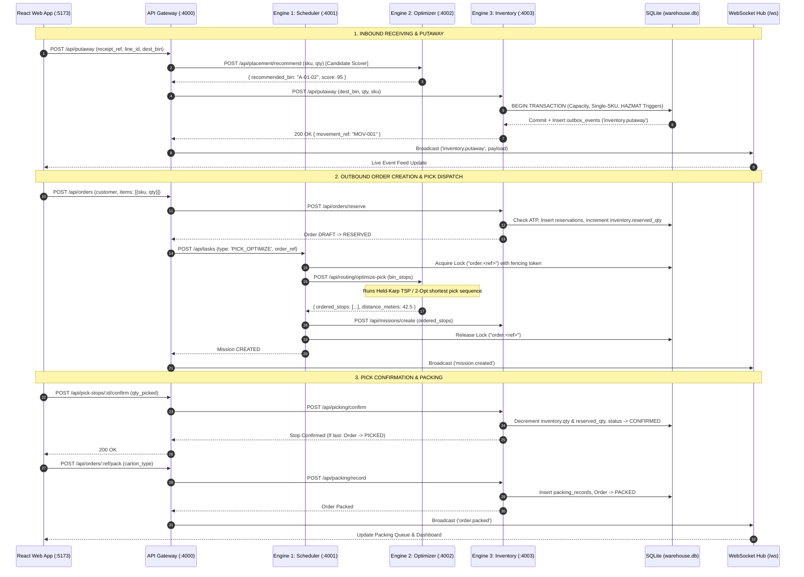

# Technical Architecture & Codebase Report (iPRD)
**Dark Storage Shelf & Allocator Platform**
*Target: Production-Grade RBAC, Segregation of Duties (SoD), and Role-Specific UI/UX Refactoring*

---

## 1. Project File Tree & Tech Stack

### 1.1 Complete Clean Directory Tree
*(Excluding `node_modules`, `.git`, `dist`, `build`, and test run artifacts)*

```text
d:\mini project final
├── .env.example
├── package.json
├── pnpm-lock.yaml
├── pnpm-workspace.yaml
├── tsconfig.json
├── data/
│   ├── warehouse.db
│   ├── scheduler.db
│   └── seed.sql
├── migrations/
│   ├── warehouse/
│   │   ├── 001_core.sql
│   │   ├── 002_catalog_layout.sql
│   │   ├── 003_inventory_ledger.sql
│   │   ├── 004_receiving.sql
│   │   ├── 005_putaway.sql
│   │   ├── 006_orders.sql
│   │   ├── 007_missions.sql
│   │   ├── 008_exceptions.sql
│   │   └── 009_packing.sql
│   └── scheduler/
│       └── s001_scheduler.sql
├── packages/
│   └── shared/
│       ├── package.json
│       ├── tsconfig.json
│       └── src/
│           ├── index.ts
│           ├── enums.ts
│           ├── types.ts
│           └── dtos.ts
├── services/
│   ├── gateway/
│   │   ├── package.json
│   │   ├── tsconfig.json
│   │   └── src/
│   │       ├── index.ts
│   │       ├── middleware/
│   │       │   ├── auth.ts
│   │       │   ├── rbac.ts
│   │       │   ├── audit.ts
│   │       │   ├── idempotency.ts
│   │       │   └── errorHandler.ts
│   │       ├── routes/
│   │       │   ├── auth.ts
│   │       │   ├── dashboard.ts
│   │       │   ├── products.ts
│   │       │   ├── warehouse.ts
│   │       │   ├── receipts.ts
│   │       │   ├── putaways.ts
│   │       │   ├── placement.ts
│   │       │   ├── inventory.ts
│   │       │   ├── orders.ts
│   │       │   ├── missions.ts
│   │       │   ├── picking.ts
│   │       │   ├── exceptions.ts
│   │       │   ├── packing.ts
│   │       │   ├── tasks.ts
│   │       │   ├── users.ts
│   │       │   ├── audit.ts
│   │       │   ├── health.ts
│   │       │   └── admin.ts
│   │       └── ws/
│   │           └── hub.ts
│   ├── engine1-scheduler/
│   │   ├── package.json
│   │   ├── tsconfig.json
│   │   └── src/
│   │       ├── index.ts
│   │       ├── db.ts
│   │       ├── queue/
│   │       │   ├── taskQueue.ts
│   │       │   └── worker.ts
│   │       ├── locks/
│   │       │   └── lockManager.ts
│   │       └── routes/
│   │           ├── tasks.ts
│   │           └── locks.ts
│   ├── engine2-optimizer/
│   │   ├── package.json
│   │   ├── tsconfig.json
│   │   └── src/
│   │       ├── index.ts
│   │       ├── routing/
│   │       │   ├── dijkstra.ts
│   │       │   ├── tspHeldKarp.ts
│   │       │   └── tspTwoOpt.ts
│   │       ├── placement/
│   │       │   └── scorer.ts
│   │       └── routes/
│   │           ├── routing.ts
│   │           └── placement.ts
│   └── engine3-inventory/
│       ├── package.json
│       ├── tsconfig.json
│       └── src/
│           ├── index.ts
│           ├── db.ts
│           ├── ledger/
│           │   ├── stockLedger.ts
│           │   ├── putawayLedger.ts
│           │   ├── orderReservations.ts
│           │   ├── pickExecution.ts
│           │   └── packingLedger.ts
│           └── routes/
│               ├── inventory.ts
│               ├── receipts.ts
│               ├── putaway.ts
│               ├── orders.ts
│               ├── picking.ts
│               ├── exceptions.ts
│               ├── packing.ts
│               └── outbox.ts
└── apps/
    └── web/
        ├── index.html
        ├── package.json
        ├── tsconfig.json
        ├── vite.config.ts
        └── src/
            ├── main.tsx
            ├── App.tsx
            ├── styles/
            │   ├── global.css
            │   └── theme.css
            ├── api/
            │   ├── client.ts
            │   └── useRealtime.ts
            ├── stores/
            │   ├── authStore.ts
            │   └── realtimeStore.ts
            ├── hooks/
            │   ├── useWarehouseData.ts
            │   └── useFloorplanInteraction.ts
            ├── components/
            │   ├── AppShell.tsx
            │   ├── StatusBadge.tsx
            │   ├── ProductLabel.tsx
            │   ├── AllocationModal.tsx
            │   ├── LabelPrintModal.tsx
            │   ├── MissionRouteSelector.tsx
            │   └── ViewErrorBoundary.tsx
            ├── features/
            │   ├── feed/
            │   │   └── EventFeedDrawer.tsx
            │   ├── floorplan/
            │   │   ├── FloorplanView.tsx
            │   │   ├── FloorplanGrid.tsx
            │   │   ├── FloorplanRouteOverlay.tsx
            │   │   └── FloorplanToolbar.tsx
            │   ├── twin/
            │   │   ├── TwinView.tsx
            │   │   ├── IsometricCanvas.tsx
            │   │   └── TwinControls.tsx
            │   └── stresslab/
            │       └── StressLabView.tsx
            └── pages/
                ├── LoginPage.tsx
                ├── HomePage.tsx
                ├── ReceivingPage.tsx
                ├── InventoryPage.tsx
                ├── OrdersPage.tsx
                ├── NewOrderPage.tsx
                ├── OrderDetailPage.tsx
                ├── PickingPage.tsx
                ├── MissionDetailPage.tsx
                ├── PackingPage.tsx
                ├── ExceptionsPage.tsx
                ├── WarehousePage.tsx
                ├── TasksPage.tsx
                └── AdminPage.tsx
```

### 1.2 Tech Stack Details

| Layer / Subsystem | Technology | Configuration / Details |
|---|---|---|
| **Frontend Framework** | React 18 (`react` 18.2.0, `react-dom` 18.2.0) | TypeScript, Vite v5.4.21 bundle pipeline |
| **Routing & Client State** | React Router v6 (`react-router-dom` 6.22.3), TanStack Query v5 (`@tanstack/react-query` 5.28.4), Zustand v4 (`zustand` 4.5.2) | Client cache invalidation on mutations; auth state in `sessionStorage` (`authStore.ts`) |
| **Styling & Design System** | Custom Material Design 3 tokenized CSS (`theme.css`, `global.css`) | Full CSS Variables theme (`--m3-*`, `--surface-*`, `--accent-*`), dark storage industrial aesthetics |
| **Warehouse Visualization** | HTML5 Canvas 2D + SVG | Custom 2.5D Isometric Engine (`IsometricCanvas.tsx`) and Top-Down SVG Floorplan with live path overlays (`FloorplanView.tsx`) |
| **Backend Runtime** | Node.js v20+ ESM (`"type": "module"`) | Express 4.18.3, JSON body parsing, CORS middleware |
| **Database Drivers & Storage** | SQLite 3 via `better-sqlite3` v9.4.3 | WAL mode (`PRAGMA journal_mode = WAL`), foreign keys enabled (`PRAGMA foreign_keys = ON`), strict synchronous write checks |
| **Databases** | `data/warehouse.db` (Engine 3 Ledger) & `data/scheduler.db` (Engine 1 Queue) | File-based SQLite, transaction isolation, trigger-based invariants |
| **Gateway Hosting & Port** | Port `4000` (`http://localhost:4000`) | API Reverse Proxy, JWT verification, Idempotency tracking, WebSocket hub `/ws` |
| **Engine 1 (Scheduler)** | Port `4001` (`http://localhost:4001`) | Priority-weighted job queue, fencing token resource lock manager (`locks`), worker polling loop |
| **Engine 2 (Optimizer)** | Port `4002` (`http://localhost:4002`) | Shortest path via Dijkstra ($O((V+E)\log V)$), TSP routing via Held-Karp ($O(n^2 2^n)$) with 2-Opt fallback, candidate bin scoring |
| **Engine 3 (Inventory Ledger)** | Port `4003` (`http://localhost:4003`) | Strict double-entry inventory ledger, outbox event generation, SQL triggers enforcing HAZMAT & capacity limits |
| **Web Dev Server** | Port `5173` (`http://localhost:5173`) | Vite HMR dev server proxying `/api` and `/ws` to `localhost:4000` |
| **Internal Inter-Engine Auth** | Shared internal secret (`x-internal-token`) | Configured via `INTERNAL_SERVICE_KEY` environment variable |

---

## 2. Complete Database Schema & State Enums

### 2.1 Exact SQL Migration Schemas

#### A. Database: `data/warehouse.db`

##### Migration `migrations/warehouse/001_core.sql`
```sql
CREATE TABLE IF NOT EXISTS users (
  id TEXT PRIMARY KEY,
  username TEXT NOT NULL UNIQUE,
  password_hash TEXT NOT NULL,
  role TEXT NOT NULL CHECK (role IN ('MANAGER', 'OPERATOR', 'PICKER', 'STAFF')),
  display_name TEXT NOT NULL,
  active INTEGER NOT NULL DEFAULT 1 CHECK (active IN (0, 1)),
  created_at TEXT NOT NULL DEFAULT (datetime('now')),
  updated_at TEXT NOT NULL DEFAULT (datetime('now'))
);

CREATE TABLE IF NOT EXISTS id_sequences (
  entity_type TEXT PRIMARY KEY,
  current_value INTEGER NOT NULL DEFAULT 0,
  updated_at TEXT NOT NULL DEFAULT (datetime('now'))
);

CREATE TABLE IF NOT EXISTS audit_log (
  id INTEGER PRIMARY KEY AUTOINCREMENT,
  at TEXT NOT NULL DEFAULT (datetime('now')),
  actor TEXT NOT NULL,
  role TEXT NOT NULL,
  action TEXT NOT NULL,
  entity_type TEXT NOT NULL,
  entity_id TEXT NOT NULL,
  details TEXT
);

CREATE TABLE IF NOT EXISTS outbox_events (
  seq INTEGER PRIMARY KEY AUTOINCREMENT,
  event_id TEXT NOT NULL UNIQUE,
  topic TEXT NOT NULL,
  aggregate_type TEXT NOT NULL,
  aggregate_id TEXT NOT NULL,
  payload TEXT NOT NULL,
  created_at TEXT NOT NULL DEFAULT (datetime('now')),
  published_at TEXT
);

CREATE TABLE IF NOT EXISTS idempotency_keys (
  key TEXT NOT NULL,
  scope TEXT NOT NULL,
  request_hash TEXT NOT NULL,
  response_code INTEGER NOT NULL,
  response_body TEXT NOT NULL,
  created_at TEXT NOT NULL DEFAULT (datetime('now')),
  PRIMARY KEY (key, scope)
);
```

##### Migration `migrations/warehouse/002_catalog_layout.sql`
```sql
CREATE TABLE IF NOT EXISTS products (
  sku TEXT PRIMARY KEY,
  name TEXT NOT NULL,
  category TEXT NOT NULL,
  storage_class TEXT NOT NULL CHECK (storage_class IN ('STANDARD', 'HAZMAT', 'TEMPERATURE_CONTROLLED', 'SECURE', 'BULK')),
  max_receive_qty INTEGER NOT NULL DEFAULT 1000,
  min_shelf_level INTEGER NOT NULL DEFAULT 1,
  max_shelf_level INTEGER NOT NULL DEFAULT 4,
  is_active INTEGER NOT NULL DEFAULT 1 CHECK (is_active IN (0, 1)),
  created_at TEXT NOT NULL DEFAULT (datetime('now')),
  updated_at TEXT NOT NULL DEFAULT (datetime('now'))
);

CREATE TABLE IF NOT EXISTS nav_nodes (
  id TEXT PRIMARY KEY,
  kind TEXT NOT NULL CHECK (kind IN ('AISLE_INTERSECTION', 'SHELF_ACCESS', 'DOCK', 'PACK_STATION', 'CHARGING_BAY')),
  label TEXT NOT NULL,
  x REAL NOT NULL,
  y REAL NOT NULL,
  z REAL NOT NULL DEFAULT 0,
  floor INTEGER NOT NULL DEFAULT 1,
  created_at TEXT NOT NULL DEFAULT (datetime('now'))
);

CREATE TABLE IF NOT EXISTS nav_edges (
  id INTEGER PRIMARY KEY AUTOINCREMENT,
  from_node TEXT NOT NULL REFERENCES nav_nodes(id) ON DELETE CASCADE,
  to_node TEXT NOT NULL REFERENCES nav_nodes(id) ON DELETE CASCADE,
  distance_cm INTEGER NOT NULL CHECK (distance_cm > 0),
  bidirectional INTEGER NOT NULL DEFAULT 1 CHECK (bidirectional IN (0, 1)),
  traversal_cost REAL NOT NULL DEFAULT 1.0,
  created_at TEXT NOT NULL DEFAULT (datetime('now')),
  UNIQUE(from_node, to_node)
);

CREATE TABLE IF NOT EXISTS shelves (
  code TEXT PRIMARY KEY,
  aisle TEXT NOT NULL,
  bay INTEGER NOT NULL,
  status TEXT NOT NULL DEFAULT 'ACTIVE' CHECK (status IN ('ACTIVE', 'MAINTENANCE', 'INACTIVE')),
  storage_class TEXT NOT NULL DEFAULT 'STANDARD' CHECK (storage_class IN ('STANDARD', 'HAZMAT', 'TEMPERATURE_CONTROLLED', 'SECURE', 'BULK')),
  access_node_id TEXT NOT NULL REFERENCES nav_nodes(id),
  x REAL NOT NULL,
  y REAL NOT NULL,
  width_cm INTEGER NOT NULL DEFAULT 120,
  depth_cm INTEGER NOT NULL DEFAULT 80,
  height_cm INTEGER NOT NULL DEFAULT 200,
  created_at TEXT NOT NULL DEFAULT (datetime('now')),
  updated_at TEXT NOT NULL DEFAULT (datetime('now'))
);

CREATE TABLE IF NOT EXISTS bins (
  code TEXT PRIMARY KEY,
  shelf_code TEXT NOT NULL REFERENCES shelves(code) ON DELETE CASCADE,
  level INTEGER NOT NULL CHECK (level BETWEEN 1 AND 10),
  capacity INTEGER NOT NULL CHECK (capacity > 0),
  status TEXT NOT NULL DEFAULT 'AVAILABLE' CHECK (status IN ('AVAILABLE', 'RESERVED', 'OCCUPIED', 'BLOCKED', 'DAMAGED', 'RECOUNT_REQUIRED')),
  recount_required INTEGER NOT NULL DEFAULT 0 CHECK (recount_required IN (0, 1)),
  current_sku TEXT REFERENCES products(sku),
  current_qty INTEGER NOT NULL DEFAULT 0 CHECK (current_qty >= 0),
  created_at TEXT NOT NULL DEFAULT (datetime('now')),
  updated_at TEXT NOT NULL DEFAULT (datetime('now')),
  CHECK (current_qty <= capacity)
);
```

##### Migration `migrations/warehouse/003_inventory_ledger.sql`
```sql
CREATE TABLE IF NOT EXISTS inventory (
  bin_code TEXT PRIMARY KEY REFERENCES bins(code) ON DELETE RESTRICT,
  sku TEXT NOT NULL REFERENCES products(sku) ON DELETE RESTRICT,
  qty INTEGER NOT NULL CHECK (qty >= 0),
  reserved_qty INTEGER NOT NULL DEFAULT 0 CHECK (reserved_qty >= 0),
  storage_class TEXT NOT NULL CHECK (storage_class IN ('STANDARD', 'HAZMAT', 'TEMPERATURE_CONTROLLED', 'SECURE', 'BULK')),
  updated_at TEXT NOT NULL DEFAULT (datetime('now')),
  CHECK (reserved_qty <= qty)
);

CREATE TABLE IF NOT EXISTS stock_movements (
  id INTEGER PRIMARY KEY AUTOINCREMENT,
  ref TEXT NOT NULL UNIQUE,
  movement_type TEXT NOT NULL CHECK (movement_type IN ('RECEIPT', 'PUTAWAY', 'PICK', 'RELOCATION', 'ADJUSTMENT')),
  movement_kind TEXT NOT NULL CHECK (movement_kind IN ('INBOUND', 'OUTBOUND', 'INTERNAL')),
  sku TEXT NOT NULL REFERENCES products(sku),
  qty INTEGER NOT NULL CHECK (qty > 0),
  from_bin_code TEXT,
  to_bin_code TEXT,
  related_ref TEXT,
  performed_by TEXT NOT NULL REFERENCES users(id),
  notes TEXT,
  created_at TEXT NOT NULL DEFAULT (datetime('now')),
  CHECK (from_bin_code IS NOT NULL OR to_bin_code IS NOT NULL)
);

CREATE VIEW IF NOT EXISTS v_available_stock AS
SELECT
  i.bin_code,
  i.sku,
  p.name AS product_name,
  p.category,
  i.storage_class,
  b.shelf_code,
  b.level,
  b.capacity,
  b.status AS bin_status,
  b.recount_required,
  s.status AS shelf_status,
  i.qty,
  i.reserved_qty,
  (i.qty - i.reserved_qty) AS available_to_promise,
  CASE
    WHEN b.status = 'AVAILABLE' AND b.recount_required = 0 AND s.status = 'ACTIVE'
    THEN (i.qty - i.reserved_qty)
    ELSE 0
  END AS atp_pickable,
  (b.capacity - i.qty) AS free_capacity
FROM inventory i
JOIN bins b ON b.code = i.bin_code
JOIN shelves s ON s.code = b.shelf_code
JOIN products p ON p.sku = i.sku;

-- SQL Triggers Enforcing Critical Invariants:
CREATE TRIGGER IF NOT EXISTS inventory_capacity_insert
BEFORE INSERT ON inventory
FOR EACH ROW
BEGIN
  SELECT CASE
    WHEN NEW.qty > (SELECT capacity FROM bins WHERE code = NEW.bin_code)
    THEN RAISE(ABORT, 'Bin capacity exceeded on insert')
  END;
END;

CREATE TRIGGER IF NOT EXISTS inventory_capacity_update
BEFORE UPDATE OF qty ON inventory
FOR EACH ROW
BEGIN
  SELECT CASE
    WHEN NEW.qty > (SELECT capacity FROM bins WHERE code = NEW.bin_code)
    THEN RAISE(ABORT, 'Bin capacity exceeded on update')
  END;
END;

CREATE TRIGGER IF NOT EXISTS inventory_sku_mix
BEFORE INSERT ON inventory
FOR EACH ROW
BEGIN
  SELECT CASE
    WHEN (SELECT current_sku FROM bins WHERE code = NEW.bin_code) IS NOT NULL
     AND (SELECT current_sku FROM bins WHERE code = NEW.bin_code) != NEW.sku
     AND (SELECT current_qty FROM bins WHERE code = NEW.bin_code) > 0
    THEN RAISE(ABORT, 'Single SKU per bin violation')
  END;
END;

CREATE TRIGGER IF NOT EXISTS inventory_receivable
BEFORE INSERT ON inventory
FOR EACH ROW
BEGIN
  SELECT CASE
    WHEN (SELECT status FROM bins WHERE code = NEW.bin_code) IN ('BLOCKED', 'DAMAGED')
    THEN RAISE(ABORT, 'Cannot store inventory in blocked or damaged bin')
    WHEN (SELECT status FROM shelves WHERE code = (SELECT shelf_code FROM bins WHERE code = NEW.bin_code)) = 'MAINTENANCE'
    THEN RAISE(ABORT, 'Cannot store inventory on shelf in maintenance')
  END;
END;

CREATE TRIGGER IF NOT EXISTS inventory_storage_class
BEFORE INSERT ON inventory
FOR EACH ROW
BEGIN
  SELECT CASE
    WHEN (SELECT storage_class FROM products WHERE sku = NEW.sku) = 'HAZMAT'
     AND (SELECT storage_class FROM shelves WHERE code = (SELECT shelf_code FROM bins WHERE code = NEW.bin_code)) != 'HAZMAT'
    THEN RAISE(ABORT, 'HAZMAT product requires a HAZMAT designated shelf')
  END;
END;
```

##### Migration `migrations/warehouse/004_receiving.sql`
```sql
CREATE TABLE IF NOT EXISTS receipts (
  id INTEGER PRIMARY KEY AUTOINCREMENT,
  ref TEXT NOT NULL UNIQUE,
  status TEXT NOT NULL DEFAULT 'PENDING' CHECK (status IN ('PENDING', 'RECEIVED', 'CANCELLED')),
  supplier TEXT,
  reference_no TEXT,
  notes TEXT,
  received_at TEXT NOT NULL DEFAULT (datetime('now')),
  received_by TEXT NOT NULL REFERENCES users(id),
  created_at TEXT NOT NULL DEFAULT (datetime('now')),
  updated_at TEXT NOT NULL DEFAULT (datetime('now'))
);

CREATE TABLE IF NOT EXISTS receipt_lines (
  id INTEGER PRIMARY KEY AUTOINCREMENT,
  receipt_ref TEXT NOT NULL REFERENCES receipts(ref) ON DELETE CASCADE,
  sku TEXT NOT NULL REFERENCES products(sku),
  qty_received INTEGER NOT NULL CHECK (qty_received > 0),
  qty_put_away INTEGER NOT NULL DEFAULT 0 CHECK (qty_put_away >= 0),
  status TEXT NOT NULL DEFAULT 'STAGED' CHECK (status IN ('STAGED', 'PARTIALLY_PUT_AWAY', 'COMPLETED', 'CANCELLED')),
  created_at TEXT NOT NULL DEFAULT (datetime('now')),
  updated_at TEXT NOT NULL DEFAULT (datetime('now')),
  CHECK (qty_put_away <= qty_received)
);
```

##### Migration `migrations/warehouse/005_putaway.sql`
```sql
CREATE TABLE IF NOT EXISTS putaways (
  id INTEGER PRIMARY KEY AUTOINCREMENT,
  ref TEXT NOT NULL UNIQUE,
  receipt_ref TEXT NOT NULL REFERENCES receipts(ref),
  receipt_line_id INTEGER NOT NULL REFERENCES receipt_lines(id),
  sku TEXT NOT NULL REFERENCES products(sku),
  qty INTEGER NOT NULL CHECK (qty > 0),
  source TEXT NOT NULL DEFAULT 'DOCK',
  dest_shelf TEXT NOT NULL REFERENCES shelves(code),
  dest_bin TEXT NOT NULL REFERENCES bins(code),
  selection_mode TEXT NOT NULL CHECK (selection_mode IN ('RECOMMENDED', 'MANUAL')),
  movement_ref TEXT NOT NULL REFERENCES stock_movements(ref),
  performed_by TEXT NOT NULL REFERENCES users(id),
  created_at TEXT NOT NULL DEFAULT (datetime('now'))
);
```

##### Migration `migrations/warehouse/006_orders.sql`
```sql
CREATE TABLE IF NOT EXISTS orders (
  id INTEGER PRIMARY KEY AUTOINCREMENT,
  ref TEXT NOT NULL UNIQUE,
  type TEXT NOT NULL DEFAULT 'CUSTOMER' CHECK (type IN ('CUSTOMER', 'TRANSFER', 'PRODUCTION')),
  status TEXT NOT NULL DEFAULT 'DRAFT' CHECK (status IN (
    'DRAFT', 'RESERVED', 'ASSIGNED', 'PICKING', 'PICKED',
    'PACKED', 'COMPLETED', 'CANCELLED', 'PARTIALLY_FULFILLED', 'FAILED'
  )),
  priority INTEGER NOT NULL DEFAULT 300 CHECK (priority IN (100, 200, 300, 400)),
  customer TEXT NOT NULL,
  shipping_address TEXT,
  carrier TEXT,
  service_level TEXT,
  notes TEXT,
  items_total INTEGER NOT NULL DEFAULT 0 CHECK (items_total >= 0),
  items_fulfilled INTEGER NOT NULL DEFAULT 0 CHECK (items_fulfilled >= 0),
  cancelled_reason TEXT,
  created_by TEXT NOT NULL REFERENCES users(id),
  created_at TEXT NOT NULL DEFAULT (datetime('now')),
  updated_at TEXT NOT NULL DEFAULT (datetime('now'))
);

CREATE TABLE IF NOT EXISTS order_lines (
  id INTEGER PRIMARY KEY AUTOINCREMENT,
  order_ref TEXT NOT NULL REFERENCES orders(ref) ON DELETE CASCADE,
  line_number INTEGER NOT NULL,
  sku TEXT NOT NULL REFERENCES products(sku),
  qty_ordered INTEGER NOT NULL CHECK (qty_ordered > 0),
  qty_reserved INTEGER NOT NULL DEFAULT 0 CHECK (qty_reserved >= 0),
  qty_picked INTEGER NOT NULL DEFAULT 0 CHECK (qty_picked >= 0),
  status TEXT NOT NULL DEFAULT 'PENDING' CHECK (status IN ('PENDING', 'RESERVED', 'PARTIALLY_RESERVED', 'PICKED', 'CANCELLED')),
  created_at TEXT NOT NULL DEFAULT (datetime('now')),
  updated_at TEXT NOT NULL DEFAULT (datetime('now')),
  UNIQUE(order_ref, line_number),
  CHECK (qty_reserved <= qty_ordered),
  CHECK (qty_picked <= qty_ordered)
);

CREATE TABLE IF NOT EXISTS reservations (
  id INTEGER PRIMARY KEY AUTOINCREMENT,
  order_ref TEXT NOT NULL REFERENCES orders(ref) ON DELETE CASCADE,
  order_line_id INTEGER NOT NULL REFERENCES order_lines(id) ON DELETE CASCADE,
  bin_code TEXT NOT NULL REFERENCES bins(code),
  sku TEXT NOT NULL REFERENCES products(sku),
  qty INTEGER NOT NULL CHECK (qty > 0),
  status TEXT NOT NULL DEFAULT 'ACTIVE' CHECK (status IN ('ACTIVE', 'RELEASED', 'FULFILLED')),
  created_at TEXT NOT NULL DEFAULT (datetime('now')),
  updated_at TEXT NOT NULL DEFAULT (datetime('now'))
);
```

##### Migration `migrations/warehouse/007_missions.sql`
```sql
CREATE TABLE IF NOT EXISTS missions (
  id INTEGER PRIMARY KEY AUTOINCREMENT,
  ref TEXT NOT NULL UNIQUE,
  order_ref TEXT NOT NULL REFERENCES orders(ref),
  status TEXT NOT NULL DEFAULT 'CREATED' CHECK (status IN ('CREATED', 'ASSIGNED', 'IN_PROGRESS', 'COMPLETED', 'CANCELLED', 'FAILED')),
  picker_id TEXT REFERENCES users(id),
  total_stops INTEGER NOT NULL DEFAULT 0,
  completed_stops INTEGER NOT NULL DEFAULT 0,
  distance_meters REAL DEFAULT 0,
  estimated_seconds INTEGER DEFAULT 0,
  started_at TEXT,
  completed_at TEXT,
  created_at TEXT NOT NULL DEFAULT (datetime('now')),
  updated_at TEXT NOT NULL DEFAULT (datetime('now'))
);

CREATE TABLE IF NOT EXISTS pick_stops (
  id INTEGER PRIMARY KEY AUTOINCREMENT,
  mission_ref TEXT NOT NULL REFERENCES missions(ref) ON DELETE CASCADE,
  stop_seq INTEGER NOT NULL CHECK (stop_seq > 0),
  bin_code TEXT NOT NULL REFERENCES bins(code),
  sku TEXT NOT NULL REFERENCES products(sku),
  qty_to_pick INTEGER NOT NULL CHECK (qty_to_pick > 0),
  qty_picked INTEGER NOT NULL DEFAULT 0 CHECK (qty_picked >= 0),
  status TEXT NOT NULL DEFAULT 'PENDING' CHECK (status IN ('PENDING', 'IN_PROGRESS', 'CONFIRMED', 'EXCEPTION')),
  confirmed_at TEXT,
  created_at TEXT NOT NULL DEFAULT (datetime('now')),
  UNIQUE(mission_ref, stop_seq),
  CHECK (qty_picked <= qty_to_pick)
);
```

##### Migration `migrations/warehouse/008_exceptions.sql`
```sql
CREATE TABLE IF NOT EXISTS pick_exceptions (
  id INTEGER PRIMARY KEY AUTOINCREMENT,
  ref TEXT NOT NULL UNIQUE,
  mission_ref TEXT NOT NULL REFERENCES missions(ref),
  stop_id INTEGER NOT NULL REFERENCES pick_stops(id),
  bin_code TEXT NOT NULL REFERENCES bins(code),
  sku TEXT NOT NULL REFERENCES products(sku),
  exception_type TEXT NOT NULL CHECK (exception_type IN (
    'SHORTAGE', 'DAMAGED', 'WRONG_ITEM', 'BIN_EMPTY', 'BARCODE_UNREADABLE'
  )),
  expected_qty INTEGER NOT NULL,
  actual_qty INTEGER NOT NULL,
  reason TEXT NOT NULL,
  resolution TEXT CHECK (resolution IN (
    'RECOUNT_REQUESTED', 'RESCHEDULE_STOP', 'SUBSTITUTE_BIN', 'CANCEL_LINE', 'WRITE_OFF'
  )),
  resolution_notes TEXT,
  reported_by TEXT NOT NULL REFERENCES users(id),
  resolved_by TEXT REFERENCES users(id),
  resolved_at TEXT,
  created_at TEXT NOT NULL DEFAULT (datetime('now'))
);
```

##### Migration `migrations/warehouse/009_packing.sql`
```sql
CREATE TABLE IF NOT EXISTS packing_records (
  id INTEGER PRIMARY KEY AUTOINCREMENT,
  ref TEXT NOT NULL UNIQUE,
  order_ref TEXT NOT NULL UNIQUE REFERENCES orders(ref),
  packed_by TEXT NOT NULL REFERENCES users(id),
  total_items INTEGER NOT NULL CHECK (total_items > 0),
  fulfilment_type TEXT NOT NULL CHECK (fulfilment_type IN ('FULL', 'PARTIAL')),
  carton_type TEXT NOT NULL DEFAULT 'STANDARD_CARTON',
  tracking_number TEXT NOT NULL,
  notes TEXT,
  created_at TEXT NOT NULL DEFAULT (datetime('now'))
);
```

---

#### B. Database: `data/scheduler.db`

##### Migration `migrations/scheduler/s001_scheduler.sql`
```sql
CREATE TABLE IF NOT EXISTS tasks (
  id TEXT PRIMARY KEY,
  type TEXT NOT NULL CHECK (type IN (
    'PUTAWAY', 'ORDER_ALLOCATE', 'PICK_OPTIMIZE',
    'RECOUNT_DISPATCH', 'SYNC_OUTBOX', 'AUDIT_INTEGRITY'
  )),
  status TEXT NOT NULL DEFAULT 'QUEUED' CHECK (status IN (
    'QUEUED', 'RUNNING', 'COMPLETED', 'FAILED', 'RETRYING', 'CANCELLED'
  )),
  priority INTEGER NOT NULL DEFAULT 300,
  payload TEXT NOT NULL,
  attempts INTEGER NOT NULL DEFAULT 0,
  max_attempts INTEGER NOT NULL DEFAULT 3,
  run_after TEXT NOT NULL DEFAULT (datetime('now')),
  started_at TEXT,
  finished_at TEXT,
  error TEXT,
  http_status INTEGER,
  created_at TEXT NOT NULL DEFAULT (datetime('now'))
);

CREATE TABLE IF NOT EXISTS locks (
  resource TEXT PRIMARY KEY,
  task_id TEXT NOT NULL,
  task_type TEXT NOT NULL,
  fencing_token INTEGER NOT NULL,
  acquired_at TEXT NOT NULL DEFAULT (datetime('now')),
  expires_at TEXT NOT NULL
);

CREATE TABLE IF NOT EXISTS lock_tokens (
  resource TEXT PRIMARY KEY,
  current_token INTEGER NOT NULL DEFAULT 0
);

CREATE TABLE IF NOT EXISTS task_events (
  id INTEGER PRIMARY KEY AUTOINCREMENT,
  task_id TEXT NOT NULL,
  event TEXT NOT NULL,
  details TEXT,
  created_at TEXT NOT NULL DEFAULT (datetime('now'))
);
```

---

### 2.2 Complete State Enums Reference
Defined in `packages/shared/src/enums.ts`:

```typescript
export const ROLES = {
  MANAGER: 'MANAGER',
  OPERATOR: 'OPERATOR',
  PICKER: 'PICKER',
  STAFF: 'STAFF'
} as const;

export const PRIORITIES = {
  URGENT: 100,
  HIGH: 200,
  NORMAL: 300,
  LOW: 400
} as const;

export const STORAGE_CLASSES = {
  STANDARD: 'STANDARD',
  HAZMAT: 'HAZMAT',
  TEMPERATURE_CONTROLLED: 'TEMPERATURE_CONTROLLED',
  SECURE: 'SECURE',
  BULK: 'BULK'
} as const;

export const SHELF_STATUSES = {
  ACTIVE: 'ACTIVE',
  MAINTENANCE: 'MAINTENANCE',
  INACTIVE: 'INACTIVE'
} as const;

export const BIN_STATUSES = {
  AVAILABLE: 'AVAILABLE',
  RESERVED: 'RESERVED',
  OCCUPIED: 'OCCUPIED',
  BLOCKED: 'BLOCKED',
  DAMAGED: 'DAMAGED',
  RECOUNT_REQUIRED: 'RECOUNT_REQUIRED'
} as const;

export const MOVEMENT_TYPES = {
  RECEIPT: 'RECEIPT',
  PUTAWAY: 'PUTAWAY',
  PICK: 'PICK',
  RELOCATION: 'RELOCATION',
  ADJUSTMENT: 'ADJUSTMENT'
} as const;

export const MOVEMENT_KINDS = {
  INBOUND: 'INBOUND',
  OUTBOUND: 'OUTBOUND',
  INTERNAL: 'INTERNAL'
} as const;

export const RECEIPT_STATUSES = {
  PENDING: 'PENDING',
  RECEIVED: 'RECEIVED',
  CANCELLED: 'CANCELLED'
} as const;

export const ORDER_TYPES = {
  CUSTOMER: 'CUSTOMER',
  TRANSFER: 'TRANSFER',
  PRODUCTION: 'PRODUCTION'
} as const;

export const ORDER_STATUSES = {
  DRAFT: 'DRAFT',
  RESERVED: 'RESERVED',
  ASSIGNED: 'ASSIGNED',
  PICKING: 'PICKING',
  PICKED: 'PICKED',
  PACKED: 'PACKED',
  COMPLETED: 'COMPLETED',
  CANCELLED: 'CANCELLED',
  PARTIALLY_FULFILLED: 'PARTIALLY_FULFILLED',
  FAILED: 'FAILED'
} as const;

export const FULFILMENT_TYPES = {
  FULL: 'FULL',
  PARTIAL: 'PARTIAL'
} as const;

export const RESERVATION_STATUSES = {
  ACTIVE: 'ACTIVE',
  RELEASED: 'RELEASED',
  FULFILLED: 'FULFILLED'
} as const;

export const MISSION_STATUSES = {
  CREATED: 'CREATED',
  ASSIGNED: 'ASSIGNED',
  IN_PROGRESS: 'IN_PROGRESS',
  COMPLETED: 'COMPLETED',
  CANCELLED: 'CANCELLED',
  FAILED: 'FAILED'
} as const;

export const PICK_STOP_STATUSES = {
  PENDING: 'PENDING',
  IN_PROGRESS: 'IN_PROGRESS',
  CONFIRMED: 'CONFIRMED',
  EXCEPTION: 'EXCEPTION'
} as const;

export const EXCEPTION_TYPES = {
  SHORTAGE: 'SHORTAGE',
  DAMAGED: 'DAMAGED',
  WRONG_ITEM: 'WRONG_ITEM',
  BIN_EMPTY: 'BIN_EMPTY',
  BARCODE_UNREADABLE: 'BARCODE_UNREADABLE'
} as const;

export const EXCEPTION_RESOLUTIONS = {
  RECOUNT_REQUESTED: 'RECOUNT_REQUESTED',
  RESCHEDULE_STOP: 'RESCHEDULE_STOP',
  SUBSTITUTE_BIN: 'SUBSTITUTE_BIN',
  CANCEL_LINE: 'CANCEL_LINE',
  WRITE_OFF: 'WRITE_OFF'
} as const;

export const TASK_TYPES = {
  PUTAWAY: 'PUTAWAY',
  ORDER_ALLOCATE: 'ORDER_ALLOCATE',
  PICK_OPTIMIZE: 'PICK_OPTIMIZE',
  RECOUNT_DISPATCH: 'RECOUNT_DISPATCH',
  SYNC_OUTBOX: 'SYNC_OUTBOX',
  AUDIT_INTEGRITY: 'AUDIT_INTEGRITY'
} as const;

export const TASK_STATUSES = {
  QUEUED: 'QUEUED',
  RUNNING: 'RUNNING',
  COMPLETED: 'COMPLETED',
  FAILED: 'FAILED',
  RETRYING: 'RETRYING',
  CANCELLED: 'CANCELLED'
} as const;

export const ROUTE_ALGORITHMS = {
  DIJKSTRA: 'DIJKSTRA',
  HELD_KARP_TSP: 'HELD_KARP_TSP',
  TWO_OPT: 'TWO_OPT',
  NEAREST_NEIGHBOR: 'NEAREST_NEIGHBOR'
} as const;

export const SELECTION_MODES = {
  RECOMMENDED: 'RECOMMENDED',
  MANUAL: 'MANUAL'
} as const;

export const NAV_NODE_KINDS = {
  AISLE_INTERSECTION: 'AISLE_INTERSECTION',
  SHELF_ACCESS: 'SHELF_ACCESS',
  DOCK: 'DOCK',
  PACK_STATION: 'PACK_STATION',
  CHARGING_BAY: 'CHARGING_BAY'
} as const;
```

---

## 3. Authentication, Session & Role Switcher Implementation

### 3.1 Backend Authentication & Role Middleware

#### Password & Token Issuance (`services/gateway/src/routes/auth.ts`)
Users are authenticated via bcrypt comparison against `warehouse.db` table `users`. Upon valid credentials, a signed JWT is returned containing `{ id, username, role, display_name }` with a 12-hour expiry.

```typescript
// services/gateway/src/routes/auth.ts (Excerpt)
authRouter.post('/login', (req, res) => {
  const { username, password } = req.body;
  const user = db.prepare('SELECT * FROM users WHERE username = ? AND active = 1').get(username) as any;
  if (!user || !bcrypt.compareSync(password, user.password_hash)) {
    return res.status(401).json({ error: 'Invalid username or password' });
  }
  const token = jwt.sign(
    { id: user.id, username: user.username, role: user.role, display_name: user.display_name },
    JWT_SECRET,
    { expiresIn: '12h' }
  );
  return res.json({ token, user: { id: user.id, username: user.username, role: user.role, display_name: user.display_name } });
});
```

#### JWT Verification Middleware (`services/gateway/src/middleware/auth.ts`)
```typescript
import { Request, Response, NextFunction } from 'express';
import jwt from 'jsonwebtoken';

const JWT_SECRET = process.env.JWT_SECRET || 'dark-storage-secret-key-change-in-prod';

export function authMiddleware(req: Request, res: Response, next: NextFunction) {
  const authHeader = req.headers.authorization;
  if (!authHeader || !authHeader.startsWith('Bearer ')) {
    return res.status(401).json({ error: 'Missing or malformed Authorization header' });
  }
  const token = authHeader.substring(7);
  try {
    const decoded = jwt.verify(token, JWT_SECRET) as any;
    req.user = decoded;
    next();
  } catch (err) {
    return res.status(401).json({ error: 'Invalid or expired token' });
  }
}
```

#### RBAC Middleware (`services/gateway/src/middleware/rbac.ts`)
```typescript
import { Request, Response, NextFunction } from 'express';
import { Role } from '@dark-storage/shared';

export function rbacMiddleware(allowedRoles: Role[]) {
  return (req: Request, res: Response, next: NextFunction) => {
    if (!req.user) {
      return res.status(401).json({ error: 'Authentication required' });
    }
    if (!allowedRoles.includes(req.user.role)) {
      return res.status(403).json({
        error: `Forbidden: role '${req.user.role}' is not authorized. Allowed: ${allowedRoles.join(', ')}`
      });
    }
    next();
  };
}
```

---

### 3.2 Frontend Auth Store (`apps/web/src/stores/authStore.ts`)
State is saved to `sessionStorage` under key `dark_storage_auth`:

```typescript
import { create } from 'zustand';
import { Role } from '@dark-storage/shared';

export interface UserSession {
  id: string;
  username: string;
  display_name: string;
  role: Role;
}

interface AuthState {
  token: string | null;
  user: UserSession | null;
  setAuth: (token: string, user: UserSession) => void;
  logout: () => void;
  hasRole: (roles: Role[]) => boolean;
}

const STORAGE_KEY = 'dark_storage_auth';

function loadInitialState(): { token: string | null; user: UserSession | null } {
  try {
    const raw = sessionStorage.getItem(STORAGE_KEY);
    if (!raw) return { token: null, user: null };
    return JSON.parse(raw);
  } catch {
    return { token: null, user: null };
  }
}

export const useAuthStore = create<AuthState>((set, get) => ({
  ...loadInitialState(),
  setAuth: (token, user) => {
    sessionStorage.setItem(STORAGE_KEY, JSON.stringify({ token, user }));
    set({ token, user });
  },
  logout: () => {
    sessionStorage.removeItem(STORAGE_KEY);
    set({ token: null, user: null });
  },
  hasRole: (roles) => {
    const u = get().user;
    if (!u) return false;
    return roles.includes(u.role);
  }
}));
```

---

### 3.3 Top Navbar Role Switcher & Sidebar Navigation

#### Role Switcher in `apps/web/src/components/AppShell.tsx`
The role switcher enables instant swapping between 4 preset accounts using hardcoded credentials against `/api/auth/login`:

```tsx
// Pre-configured accounts for rapid role swapping
const roleAccounts: Record<Role, { username: string; pass: string }> = {
  MANAGER: { username: 'manager1', pass: 'Warehouse#2026' },
  OPERATOR: { username: 'operator1', pass: 'Warehouse#2026' },
  PICKER: { username: 'picker1', pass: 'Warehouse#2026' },
  STAFF: { username: 'staff1', pass: 'Warehouse#2026' }
};

// Top bar switcher JSX:
<div style={{ display: 'flex', alignItems: 'center', gap: '8px' }}>
  <span style={{ fontSize: '12px', color: 'var(--text-muted)' }}>Role:</span>
  <select
    className="select"
    style={{ padding: '4px 8px', fontSize: '13px', width: 'auto' }}
    value={user?.role || 'MANAGER'}
    onChange={(e) => handleSwitchRole(e.target.value as Role)}
    disabled={switchingRole}
    data-testid="header-role-switcher"
  >
    <option value="MANAGER">MANAGER</option>
    <option value="OPERATOR">OPERATOR</option>
    <option value="PICKER">PICKER</option>
    <option value="STAFF">STAFF</option>
  </select>
</div>
```

#### Sidebar Navigation Role Filter (`apps/web/src/components/AppShell.tsx`)
```tsx
const role = user?.role;
const isManager = role === 'MANAGER';
const isReceivingRole = isManager || role === 'OPERATOR';
const isPickingRole = isManager || role === 'PICKER';
const isPackingRole = isManager || role === 'STAFF';

const navLinks = [
  { to: '/', label: 'Dashboard', icon: '📊', show: true },
  { to: '/warehouse', label: 'Warehouse', icon: '🏢', show: true },
  { to: '/inventory', label: 'Inventory', icon: '📦', show: true },
  { to: '/receiving', label: 'Receiving', icon: '📥', show: isReceivingRole },
  { to: '/orders', label: 'Orders', icon: '📋', show: true },
  { to: '/picking', label: 'Picking', icon: '🛒', show: isPickingRole },
  { to: '/packing', label: 'Packing', icon: '📦', show: isPackingRole },
  { to: '/exceptions', label: 'Exceptions', icon: '⚠️', show: true },
  { to: '/tasks', label: 'Tasks', icon: '⚡', show: isManager },
  { to: '/admin', label: 'Admin', icon: '⚙️', show: isManager }
];
```

---

## 4. Backend API Routes, Controllers & Middleware

The following table documents all endpoints registered on the Gateway (`services/gateway/src/routes/*`):

| Module | Method & Route | Controller File & Function | Middleware / Role Restriction | Request Body / Query Params | Database Mutations & State Transitions |
|---|---|---|---|---|---|
| **Auth** | `POST /api/auth/login` | `routes/auth.ts` -> inline handler | Public | Body: `{ username, password }` | None (reads `users`). Returns signed JWT. |
| **Auth** | `GET /api/auth/me` | `routes/auth.ts` -> inline handler | `authMiddleware` (Any role) | None | None (reads `users` by `req.user.id`). |
| **Dashboard** | `GET /api/dashboard` | `routes/dashboard.ts` -> inline handler | `authMiddleware` (Any role) | None | Aggregates KPIs from `receipt_lines`, `inventory`, `orders`, `missions`, `pick_exceptions`, `tasks`. |
| **Receiving** | `POST /api/receipts` | `routes/receipts.ts` -> inline handler | `authMiddleware`, `rbac(['MANAGER', 'OPERATOR'])`, `idempotency`, `audit` | Body: `{ supplier?, reference_no?, notes?, lines: [{ sku, qty }] }` | Generates receipt ref `RCV-yyyymmdd-xxxx`. Inserts into `receipts` (status `PENDING`), inserts into `receipt_lines` (status `STAGED`). Inserts `outbox_events` (`receipt.created`). |
| **Receiving** | `GET /api/receipts` | `routes/receipts.ts` -> inline handler | `authMiddleware` (Any role) | Query: `search`, `status`, `page`, `limit` | None. Reads `receipts` and aggregates line counts. |
| **Receiving** | `GET /api/receipts/staged` | `routes/receipts.ts` -> inline handler | `authMiddleware` (Any role) | None | Reads un-putaway lines (`qty_received - qty_put_away > 0`) from `receipt_lines`. |
| **Receiving** | `GET /api/receipts/:ref` | `routes/receipts.ts` -> inline handler | `authMiddleware` (Any role) | Path: `ref` | Reads `receipts` and child `receipt_lines`. |
| **Putaway** | `POST /api/putaway` | `routes/putaways.ts` -> inline handler | `authMiddleware`, `rbac(['MANAGER', 'OPERATOR'])`, `idempotency`, `audit` | Body: `{ receipt_ref, line_id, dest_bin, selection_mode? }` | Enforces single-SKU and capacity triggers. Inserts/updates `inventory`, updates `bins` (`current_sku`, `current_qty`), inserts `stock_movements` (type `PUTAWAY`), updates `receipt_lines` (`qty_put_away`, transitions to `PARTIALLY_PUT_AWAY` or `COMPLETED`), inserts `putaways`, inserts `outbox_events`. |
| **Putaway** | `GET /api/putaways` | `routes/putaways.ts` -> inline handler | `authMiddleware` (Any role) | Query: `limit`, `offset` | Reads `putaways` table joined with products and receipts. |
| **Placement** | `POST /api/placement/evaluate` | `routes/placement.ts` -> inline handler | `authMiddleware`, `rbac(['MANAGER', 'OPERATOR'])` | Body: `{ sku, qty, source_node_id? }` | Calls Engine 2 (`POST http://localhost:4002/api/placement/recommend`). Read-only scoring calculation. |
| **Inventory** | `GET /api/inventory/summary` | `routes/inventory.ts` -> inline handler | `authMiddleware` (Any role) | Query: `search`, `limit`, `offset` | Reads aggregate stock per SKU, reserved stock, and computes ATP. |
| **Inventory** | `GET /api/inventory/bins` | `routes/inventory.ts` -> inline handler | `authMiddleware` (Any role) | Query: `sku`, `shelf`, `status`, `occupied`, `limit` | Reads `bins` joined with `inventory`. |
| **Inventory** | `GET /api/inventory/bins/:code` | `routes/inventory.ts` -> inline handler | `authMiddleware` (Any role) | Path: `code` | Reads single bin metadata, inventory row, and last 10 movements. |
| **Inventory** | `POST /api/inventory/bins/:code/status` | `routes/inventory.ts` -> inline handler | `authMiddleware`, `rbac(['MANAGER'])`, `audit` | Path: `code`, Body: `{ status }` | Updates `bins.status`. (Allowed: `AVAILABLE`, `BLOCKED`, `DAMAGED`). |
| **Inventory** | `POST /api/inventory/bins/:code/recount` | `routes/inventory.ts` -> inline handler | `authMiddleware`, `rbac(['MANAGER'])`, `audit` | Path: `code`, Body: `{ actual_qty, sku, reason }` | Adjusts `inventory.qty` and `bins.current_qty`. Inserts `stock_movements` (type `ADJUSTMENT`). Resets `bins.recount_required = 0`. |
| **Inventory** | `POST /api/inventory/relocate` | `routes/inventory.ts` -> inline handler | `authMiddleware`, `rbac(['MANAGER', 'OPERATOR'])`, `idempotency`, `audit` | Body: `{ from_bin, to_bin, sku, qty }` | Decrements `from_bin` inventory, increments `to_bin` inventory. Updates both bins. Inserts `stock_movements` (type `RELOCATION`). |
| **Inventory** | `GET /api/inventory/movements` | `routes/inventory.ts` -> inline handler | `authMiddleware` (Any role) | Query: `sku`, `type`, `limit`, `page` | Reads `stock_movements` log. |
| **Orders** | `POST /api/orders` | `routes/orders.ts` -> inline handler | `authMiddleware`, `rbac(['MANAGER'])`, `idempotency`, `audit` | Body: `{ customer, priority?, lines: [{ sku, qty }] }` | Inserts `orders` (status `DRAFT`). Enforces ATP stock check. Allocates inventory by inserting `reservations` (status `ACTIVE`), increments `inventory.reserved_qty`, updates order status to `RESERVED`. Enqueues scheduler task `PICK_OPTIMIZE`. |
| **Orders** | `GET /api/orders` | `routes/orders.ts` -> inline handler | `authMiddleware` (Any role) | Query: `status`, `priority`, `search`, `page`, `page_size` | Reads `orders` list with pagination. |
| **Orders** | `GET /api/orders/:ref` | `routes/orders.ts` -> inline handler | `authMiddleware` (Any role) | Path: `ref` | Reads `orders`, `order_lines`, `reservations`, and `packing_records`. |
| **Orders** | `POST /api/orders/:ref/cancel` | `routes/orders.ts` -> inline handler | `authMiddleware`, `rbac(['MANAGER'])`, `audit` | Path: `ref`, Body: `{ reason? }` | Decrements `inventory.reserved_qty`, marks `reservations` `RELEASED`, cancels any linked `missions` (`CANCELLED`), marks `orders.status = 'CANCELLED'`. |
| **Orders** | `POST /api/orders/:ref/assign` | `routes/orders.ts` -> inline handler | `authMiddleware`, `rbac(['MANAGER'])`, `audit` | Path: `ref`, Body: `{ picker_id }` | Updates `missions.picker_id = :picker_id` and `missions.status = 'ASSIGNED'`, updates `orders.status = 'ASSIGNED'`. |
| **Orders** | `POST /api/orders/:ref/pack` | `routes/orders.ts` -> inline handler | `authMiddleware`, `rbac(['STAFF', 'MANAGER'])`, `idempotency`, `audit` | Path: `ref`, Body: `{ carton_type?, notes?, accept_partial? }` | Checks order is `PICKED`. Generates tracking number, inserts `packing_records`, updates `orders.status = 'PACKED'` (or `PARTIALLY_FULFILLED`), updates order completion time. |
| **Picking** | `GET /api/missions` | `routes/missions.ts` -> inline handler | `authMiddleware` (Any role) | Query: `status`, `picker_id`, `page`, `page_size` | Non-managers only see missions where `picker_id = req.user.id`. |
| **Picking** | `GET /api/missions/:ref` | `routes/missions.ts` -> inline handler | `authMiddleware` (Any role) | Path: `ref` | Reads mission, stops (`pick_stops`), order ref, and calls Engine 2 for TSP pick route geometry. |
| **Picking** | `POST /api/missions/:ref/start` | `routes/missions.ts` -> inline handler | `authMiddleware`, `rbac(['PICKER', 'MANAGER'])` | Path: `ref` | Updates `missions.status = 'IN_PROGRESS'`, `missions.started_at = now()`, `orders.status = 'PICKING'`. |
| **Picking** | `POST /api/pick-stops/:stopRef/confirm` | `routes/picking.ts` -> inline handler | `authMiddleware`, `rbac(['PICKER', 'MANAGER'])`, `idempotency`, `audit` | Path: `stopRef`, Body: `{ qty_picked }` | Decrements `inventory.qty` and `inventory.reserved_qty`, updates `bins.current_qty`, marks reservation `FULFILLED`, updates `pick_stops` (`status = 'CONFIRMED'`), inserts `stock_movements` (type `PICK`). If last stop, marks `missions.status = 'COMPLETED'` and `orders.status = 'PICKED'`. |
| **Picking** | `POST /api/pick-stops/:stopRef/exception` | `routes/picking.ts` -> inline handler | `authMiddleware`, `rbac(['PICKER', 'MANAGER'])`, `idempotency`, `audit` | Path: `stopRef`, Body: `{ type, actual_qty, reason }` | Inserts `pick_exceptions` (status open), marks `pick_stops.status = 'EXCEPTION'`. If bin empty/shortage, sets `bins.recount_required = 1`. |
| **Exceptions**| `GET /api/exceptions` | `routes/exceptions.ts` -> inline handler | `authMiddleware` (Any role) | Query: `status`, `mission`, `page`, `page_size` | Reads `pick_exceptions` joined with stops, missions, and users. |
| **Exceptions**| `POST /api/exceptions/:ref/resolve` | `routes/exceptions.ts` -> inline handler | `authMiddleware`, `rbac(['MANAGER'])`, `idempotency`, `audit` | Path: `ref`, Body: `{ resolution, recount_qty?, notes? }` | Updates `pick_exceptions` (`resolved_by`, `resolution`, `resolved_at`). If resolution is `RECOUNT_REQUESTED`, adjusts inventory & creates `ADJUSTMENT` movement. |
| **Packing** | `GET /api/packing/queue` | `routes/packing.ts` -> inline handler | `authMiddleware`, `rbac(['STAFF', 'MANAGER'])` | None | Returns orders with status `PICKED` or ready for carton packing. |
| **Packing** | `POST /api/packing/:ref/pack` | `routes/packing.ts` -> inline handler | `authMiddleware`, `rbac(['STAFF', 'MANAGER'])`, `idempotency`, `audit` | Path: `ref`, Body: `{ carton_type, notes, accept_partial }` | Secondary alias pointing to the packing logic. |
| **Warehouse** | `GET /api/warehouse/layout` | `routes/warehouse.ts` -> inline handler | `authMiddleware` (Any role) | None | Reads full topology: `shelves`, `bins`, `nav_nodes`, and `nav_edges`. |
| **Warehouse** | `GET /api/warehouse/mission-route/:missionRef` | `routes/warehouse.ts` -> inline handler | `authMiddleware` (Any role) | Path: `missionRef` | Fetches mission stops, queries Engine 2 for TSP route, returns coordinates and ordered waypoints. |
| **Tasks** | `GET /api/tasks` | `routes/tasks.ts` -> inline handler | `authMiddleware`, `rbac(['MANAGER'])` | Query: `status`, `type` | Calls Engine 1 (`GET http://localhost:4001/api/tasks`). |
| **Tasks** | `GET /api/tasks/locks` | `routes/tasks.ts` -> inline handler | `authMiddleware`, `rbac(['MANAGER'])` | None | Calls Engine 1 (`GET http://localhost:4001/api/locks`). |
| **Tasks** | `POST /api/tasks/locks/release` | `routes/tasks.ts` -> inline handler | `authMiddleware`, `rbac(['MANAGER'])` | Body: `{ resource }` | Calls Engine 1 (`POST http://localhost:4001/api/locks/release`). |
| **Admin** | `GET /api/audit` | `routes/audit.ts` -> inline handler | `authMiddleware`, `rbac(['MANAGER'])` | Query: `actor_id`, `action`, `entity_type`, `page`, `limit` | Reads `audit_log` with search filters. |
| **Admin** | `GET /api/admin/integrity` | `routes/admin.ts` -> inline handler | `authMiddleware`, `rbac(['MANAGER'])` | None | Runs 6 consistency checks: negative stock, bin over-capacity, orphan reservations, unlinked stops, missing SKU refs. |
| **Health** | `GET /api/health` | `routes/health.ts` -> inline handler | Public | None | Pings Engine 1, 2, 3 and returns `{ gateway: 'ok', engine1, engine2, engine3 }`. |

---

## 5. Frontend Pages & Component Breakdown

### 5.1 `HomePage.tsx` (Warehouse Operations Dashboard)
- **File:** `apps/web/src/pages/HomePage.tsx`
- **Component Structure:**
  1. **Page Header:** Title, subtitle, and responsive layout.
  2. **Service Health Strip (`HealthStatus`):** Polls `/api/health` every 10 seconds. Renders 4 status pills (`Gateway`, `Engine 1: Scheduler`, `Engine 2: Optimizer`, `Engine 3: Inventory`) with green/red dot indicators.
  3. **Live Event Feed Drawer (`EventFeedDrawer.tsx`):** Expandable slide-out displaying WebSocket events received from `/ws` in real time.
  4. **KPI Grid (7 Metric Cards):**
     - *Staged Units:* `dashboard.receiving.staged_units` & waiting lines count.
     - *Reserved Units:* `dashboard.inventory.reserved_units` committed to orders.
     - *Available (ATP):* `dashboard.inventory.available_units` vs stored units.
     - *Pending Orders:* `dashboard.orders.reserved + dashboard.orders.assigned`.
     - *Active Missions:* `dashboard.missions.in_progress` & assigned missions.
     - *Completed Today:* `dashboard.orders.completed_today` & all-time total.
     - *Open Exceptions:* `dashboard.exceptions.open` (highlighted in red if $>0$).
  5. **Warehouse Capacity Card:** Shows occupied bins vs total bins, percentage fill bar (`.fill-bar-inner`), plus scheduler queue count and 24h failure count.
  6. **Today's Movements Throughput:** 5 stat cards breaking down daily movements by type: `RECEIVE`, `PUTAWAY`, `PICK`, `RELOCATE`, `ADJUST`.
  7. **Latest Stock Movements Table:** Tabular feed of the 10 most recent transactions with Ref, Type badge, Product/SKU, Quantity, Source Bin, Destination Bin, and Timestamp.

---

### 5.2 Sidebar Pages Breakdown

#### 1. Receiving Page (`apps/web/src/pages/ReceivingPage.tsx`)
- **Tabs:** `intake` | `staged` | `receipts` | `putaways`
- **Actions & Forms:**
  - *Intake Tab:* Add product lines by SKU/Name search (`/api/products`), set intake quantities, specify supplier and external PO reference, and submit `POST /api/receipts` with UUID idempotency key.
  - *Staged Tab:* Displays all received goods sitting at the dock. Clicking **Allocate & Put Away** opens `AllocationModal`.
  - *Allocation Modal:* Queries Engine 2 (`POST /api/placement/evaluate`) for recommended bins, allows manual bin override, and triggers `POST /api/putaway`.
  - *Receipts Tab:* Search past receipts, view detailed line breakdowns, and print dock labels (`LabelPrintModal`).
  - *Putaways Tab:* Historical ledger of completed putaways showing selection mode (`RECOMMENDED` vs `MANUAL`).

#### 2. Inventory Page (`apps/web/src/pages/InventoryPage.tsx`)
- **Tabs:** `summary` | `bins` | `ledger`
- **Actions & Forms:**
  - *Summary Tab:* Filter inventory by SKU, search term, or category. Displays Available to Promise (ATP), Staged, and Reserved quantities.
  - *Bins Tab:* Filter bins by shelf, storage class, status, or occupancy. Clicking a bin displays details and recent movements.
  - *Recount Modal:* Authorized Managers can submit cycle counts (`POST /api/inventory/bins/:code/recount`), correcting inventory and generating `ADJUSTMENT` movement records.
  - *Relocate Modal:* Operators and Managers can move inventory from one bin to another (`POST /api/inventory/relocate`) with client-side capacity and HAZMAT validation.
  - *Ledger Tab:* Complete audit trail of all warehouse movements.

#### 3. Orders Page (`apps/web/src/pages/OrdersPage.tsx`) & Sub-pages
- **Sub-pages:** `NewOrderPage.tsx`, `OrderDetailPage.tsx`
- **Actions & Forms:**
  - *Order Listing:* Filter by status (`DRAFT`, `RESERVED`, `ASSIGNED`, `PICKING`, `PICKED`, `PACKED`, `COMPLETED`, `CANCELLED`) and priority.
  - *New Order Form (`/orders/new`):* Manager adds items, customer name, carrier, shipping address, and priority. Submitting calls `POST /api/orders` which atomically claims inventory reservations and dispatches `PICK_OPTIMIZE` to Engine 1.
  - *Order Detail View (`/orders/:ref`):* Visual progress bar (Draft $\rightarrow$ Reserved $\rightarrow$ Picking $\rightarrow$ Picked $\rightarrow$ Packed $\rightarrow$ Completed), line-item picking breakdown, assigned picker details, and Manager action to cancel order (`POST /api/orders/:ref/cancel`).

#### 4. Picking Page (`apps/web/src/pages/PickingPage.tsx`) & Detail (`MissionDetailPage.tsx`)
- **Actions & Forms:**
  - *Missions List:* Pickers only see their assigned missions; Managers see all missions with status filters.
  - *Mission Detail View (`/picking/:ref`):* Shows ordered sequence of pick stops computed by Engine 2 TSP.
  - *Start Mission Button:* Transitions mission to `IN_PROGRESS`.
  - *Confirm Pick Form:* Picker confirms quantity picked at each bin location (`POST /api/pick-stops/:stopRef/confirm`).
  - *Raise Exception Modal:* If a bin is short or damaged, picker reports exception (`POST /api/pick-stops/:stopRef/exception`) specifying exception type and actual found quantity.
  - *Route Preview:* Visual preview of the walking path on the top-down floorplan.

#### 5. Packing Page (`apps/web/src/pages/PackingPage.tsx`)
- **Actions & Forms:**
  - *Packing Queue:* Real-time polling list of orders in status `PICKED`.
  - *Order Packing Panel:* Staff reviews picked items, selects carton type (`STANDARD_CARTON`, `HEAVY_DUTY`, `PALLET`), enters packing notes.
  - *Partial Fulfilment Toggle:* If items are missing, Managers can toggle "Accept Partial Fulfilment".
  - *Confirm Pack Button:* Calls `POST /api/orders/:ref/pack`, generates tracking number, records packing details in `packing_records`, and transitions order to `PACKED` or `PARTIALLY_FULFILLED`.

#### 6. Exceptions Page (`apps/web/src/pages/ExceptionsPage.tsx`)
- **Actions & Forms:**
  - *Exception Queue:* Displays open picking discrepancies (`SHORTAGE`, `DAMAGED`, `WRONG_ITEM`, `BIN_EMPTY`).
  - *Resolve Exception Modal:* Managers choose a resolution (`RECOUNT_REQUESTED`, `RESCHEDULE_STOP`, `SUBSTITUTE_BIN`, `CANCEL_LINE`, `WRITE_OFF`), submit recount quantities, and call `POST /api/exceptions/:ref/resolve`.

#### 7. Warehouse Page (`apps/web/src/pages/WarehousePage.tsx`)
- **Views:** `cards` | `map` (SVG Floorplan) | `3d` (Canvas Isometric Digital Twin)
- **Actions & Controls:**
  - *Search & Locate:* Highlights matching shelf or bin across 2D/3D views.
  - *Interactive SVG Floorplan:* Clickable bins showing live fill levels, status badges, and active mission path overlays.
  - *Canvas Isometric Twin:* Rendered isometric layout with camera controls (pan, zoom, tilt) and visual heatmaps.
  - *Bin Label Printing:* Opens `LabelPrintModal` to print barcode labels for any shelf or bin.

#### 8. Tasks Page (`apps/web/src/pages/TasksPage.tsx`)
- **Sub-tabs:** `tasks` | `locks` | `queue`
- **Actions & Controls:**
  - *Tasks List:* Monitors Engine 1 background execution (`PUTAWAY`, `ORDER_ALLOCATE`, `PICK_OPTIMIZE`, etc.) with attempt counts, execution duration, and error codes.
  - *Resource Locks View:* Inspects active distributed locks held on shelves, bins, or SKUs with fencing tokens and expiration timers.
  - *Manual Lock Release:* Manager can force-release a stuck lock.

#### 9. Admin Page (`apps/web/src/pages/AdminPage.tsx`)
- **Tabs:** `overview` (Audit Log) | `integrity` (Database Check) | `stresslab`
- **Actions & Controls:**
  - *Audit Log Table:* Search and paginate audit events by actor, action, entity type, and date range.
  - *Integrity Health Check:* Runs SQL integrity validations on stock consistency, orphan records, and trigger health.
  - *Stress Lab View:* Simulation runner for throughput benchmarks and high-concurrency order simulations.

---

## 6. The 4-Engine Integration & Real-Time Event Flow



### Real-Time Event Hub (`services/gateway/src/ws/hub.ts`)
- **Connection:** Web client connects to `ws://localhost:4000/ws?token=<jwt>&since=<seq>`.
- **Event Polling Loop:** The Gateway runs a background timer every 1000ms checking `SELECT * FROM outbox_events WHERE seq > :lastSeq ORDER BY seq ASC`.
- **Gap-Free Replay:** If the client disconnects and reconnects with `since=42`, the hub queries and streams all events where `seq > 42` before switching to live broadcast.
- **Client Handler:** `apps/web/src/api/useRealtime.ts` receives messages, pushes events into Zustand `realtimeStore.ts`, and automatically calls `queryClient.invalidateQueries` matching the event's topic (e.g., `inventory.*` invalidates `['inventory']` and `['dashboard']`).

---

## 7. Current Gaps & Hardcoded Logic

The following technical debt, SoD discrepancies, and security vulnerabilities were identified in the codebase:

### 7.1 Security & Route Guarding Gaps
1. **Frontend Route Protection Lacks Role Guards (`apps/web/src/App.tsx`):**
   `ProtectedLayout` only verifies `if (!token) return <Navigate to="/login" />`. There are **no role checks** wrapping individual route components. A logged-in `PICKER` or `STAFF` can manually navigate to `/admin`, `/tasks`, `/orders/new`, or `/receiving` in the browser address bar. Although API mutations may fail with 403, the internal pages and read-only views render.
2. **Global GET Endpoints Lack Role Restrictions:**
   Endpoints such as `GET /api/inventory/summary`, `GET /api/inventory/bins`, `GET /api/inventory/movements`, `GET /api/receipts`, and `GET /api/orders` have no role checks. Any authenticated user (including temporary warehouse staff) can dump all customer orders, inventory movements, and system logs.

### 7.2 Segregation of Duties (SoD) Deficiencies
1. **No Check Preventing Order Creator from Picking or Packing:**
   In `orders.ts` and `packing.ts`, there is no validation preventing the manager who created an order (`orders.created_by`) from assigning the mission to themselves, confirming the pick stops, and completing packing. In standard warehouse compliance (SoD), inbound receiving personnel, order creators, pickers, and packers must be distinct actors.
2. **Pickers Cannot Self-Claim Missions:**
   `POST /api/orders/:ref/assign` is restricted to `MANAGER` only (`rbacMiddleware(['MANAGER'])`). A picker cannot claim an unassigned mission from a shared queue; a manager must manually assign the mission to their user ID.
3. **Operator Blocked from Packing:**
   `ordersRouter.post('/:ref/pack')` and `packingRouter.post('/:ref/pack')` restrict packing to `STAFF` and `MANAGER`. An `OPERATOR` is blocked from packing, even though operators possess general warehouse floor authority.

### 7.3 Schema & Relational Gaps
1. **Missing Tote / Cart Tracking (`tote_id`):**
   `pick_stops` and `missions` lack a `tote_id` or `cart_barcode` column. Pickers pick directly to an abstract mission without scanning a physical tote or mobile picking cart.
2. **Missing Secondary Approval on Exceptions (`approved_by`):**
   In `pick_exceptions`, when a manager resolves an exception with a stock adjustment (`RECOUNT_REQUESTED` or `WRITE_OFF`), the resolution is applied immediately in a single step without requiring secondary supervisor sign-off or dual-control authorization.
3. **Hardcoded Demo Accounts in Frontend (`apps/web/src/components/AppShell.tsx`):**
   The `roleAccounts` dictionary hardcodes plaintext passwords (`Warehouse#2026`) directly into the client bundle to power the quick role switcher. While helpful for testing, this must be isolated or guarded in production environments.

---

### Summary Checklist for RBAC / SoD Refactoring Plan

| Area | Current State | Required Target State |
|---|---|---|
| **Route Protection** | Only checks token presence | Role-aware route wrapper (`<RequireRole allowed={['MANAGER']}>`) |
| **Pick Mission Claiming** | Manager must manually assign (`/orders/:ref/assign`) | Pickers can self-claim unassigned missions via `/api/missions/:ref/claim` |
| **Order Creator $\neq$ Packer** | Unenforced | Hard SoD check in `/api/orders/:ref/pack`: `packed_by !== order.created_by` |
| **Exception Dual Sign-off** | Single-step manager resolution | Supervisor dual-authorization for write-offs exceeding threshold quantity |
| **Physical Tote Verification** | Absent | Add `tote_barcode` to `missions` and validate tote scan on pick stop confirmation |
| **Role Switcher** | Hardcoded credentials in client component | Secure session impersonation or environment-gated development tool |
